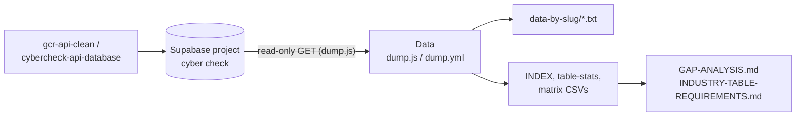

# Data

Snapshot export of the CyberCheck / Gulf Coast Radar business database, one text file per business, plus summary spreadsheets.

## What it is

A data folder, not an application. It holds a read-only export of the production Supabase project (the one named "cyber check") saved as plain files so the contents can be browsed and analysed without touching the database. Each business listing (restaurants, rentals, charters, and so on) gets one file showing every table row attached to its slug, and a few CSVs and notes summarise what data exists and what is missing.

## How it works

- `data-by-slug/<slug>.txt`: 4,476 files, one per business, each with an index of tables followed by every row. Committed output of an earlier run.
- `INDEX-all-businesses.csv`: one row per business (4,475 rows): slug, name, industry, subtype, batch, folder, table count, row count, table names.
- `table-stats.csv`: 309 tables with total rows, slug-attached rows and distinct slugs.
- `industry-table-matrix.csv` and `subtype-table-matrix.csv`: which tables each industry or subtype uses.
- `GAP-ANALYSIS.md` and `INDUSTRY-TABLE-REQUIREMENTS.md`: written analysis of tables that have data, tables that are empty, and what each industry should have. `scripts/build-must-have-inventory.mjs` is the script behind the inventory.
- `FAILED-tables.txt`: tables the last run could not read. It lists `entity`, which hit a statement timeout, so entity data may be incomplete in some files.
- `dump.js`: Node script that pages through every table with read-only GET requests to the Supabase REST API and writes files grouped into folders of at most 1,000 slugs under `data-by-slug-batches/` (the committed snapshot uses the flat `data-by-slug/` layout instead).
- `.github/workflows/dump.yml`: manual "Full Database Dump" workflow that runs `node dump.js` and commits results back to `main`.

## Run it

Reading needs nothing: open any file in `data-by-slug/` or the CSVs.

Regenerating needs Node 18+ (global `fetch`) and network access to the database:

```bash
export SUPABASE_URL=...            # optional, dump.js has a default project URL
export SUPABASE_SERVICE_KEY=...    # required, a key that can read every table
node dump.js
```

The workflow reads the same two names, `SUPABASE_URL` and `SUPABASE_SERVICE_KEY`. Nothing in this repo writes to the database.

## Status

Asset dump: a large one-off export with the tooling to regenerate it, not something a running system reads.

## Where it fits



## Related repos

- gcr-api-clean and cybercheck-api-database: serve the same database this repo exports.
- gar-profiles-, trip-swipe-live and other front ends show the same businesses that appear in the slug files.
- gcr-unified and gcr-unified-v2: earlier repos with similar export scripts.
